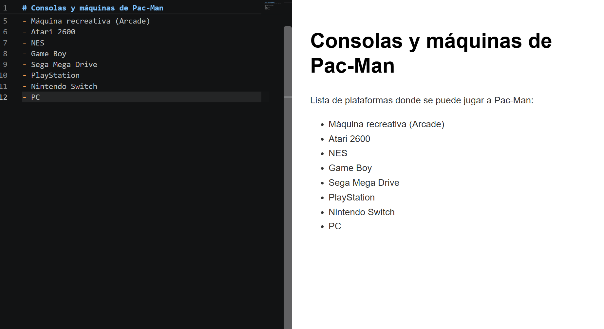
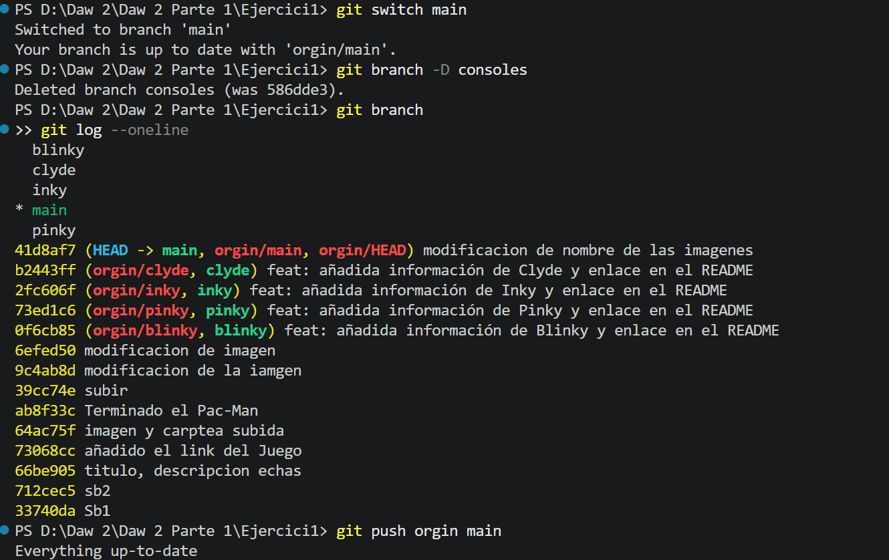
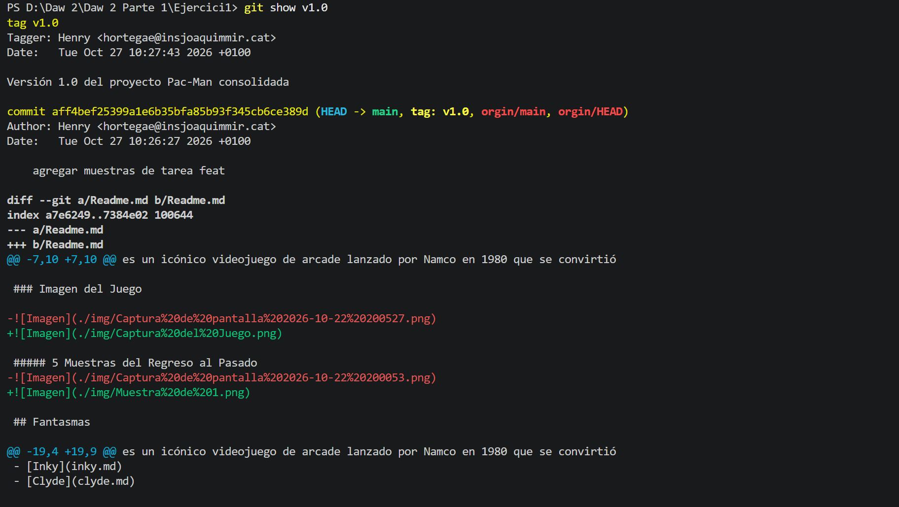
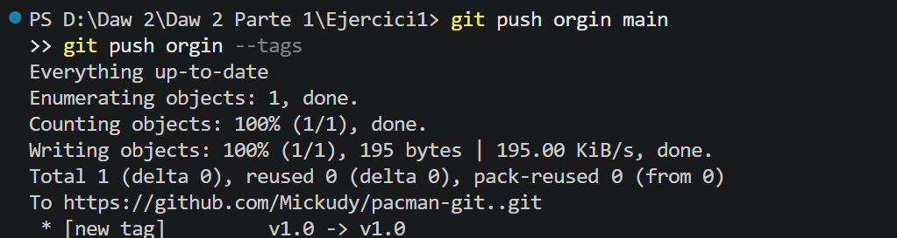
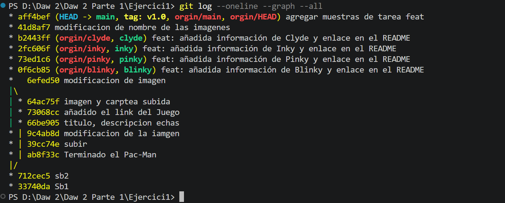
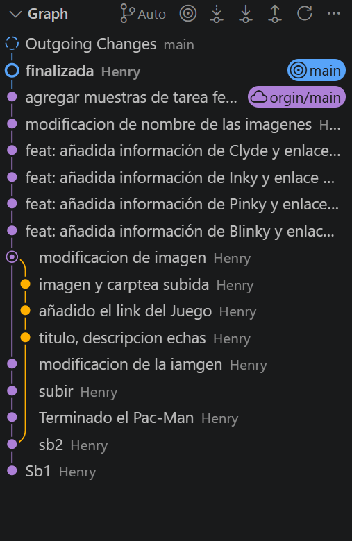

# PaC-Man
es un icónico videojuego de arcade lanzado por Namco en 1980 que se convirtió en un fenómeno de la cultura pop mundial.

**Autor: Henry Ortega**

**Juegalo Ahora:** [Enlace del Juego](https://pacmangratis.net/.)

### Imagen del Juego

##### 5 Muestras del Regreso al Pasado

## Fantasmas

- [Blinky](blinky.md)
- [Pinky](pinky.md)
- [Inky](inky.md)
- [Clyde](clyde.md)

### Muestra del Hisotria de la branch
 

### Muestra de Console

### Muestra del Tag

### Muestra de la Grafica de mi Repositorio
